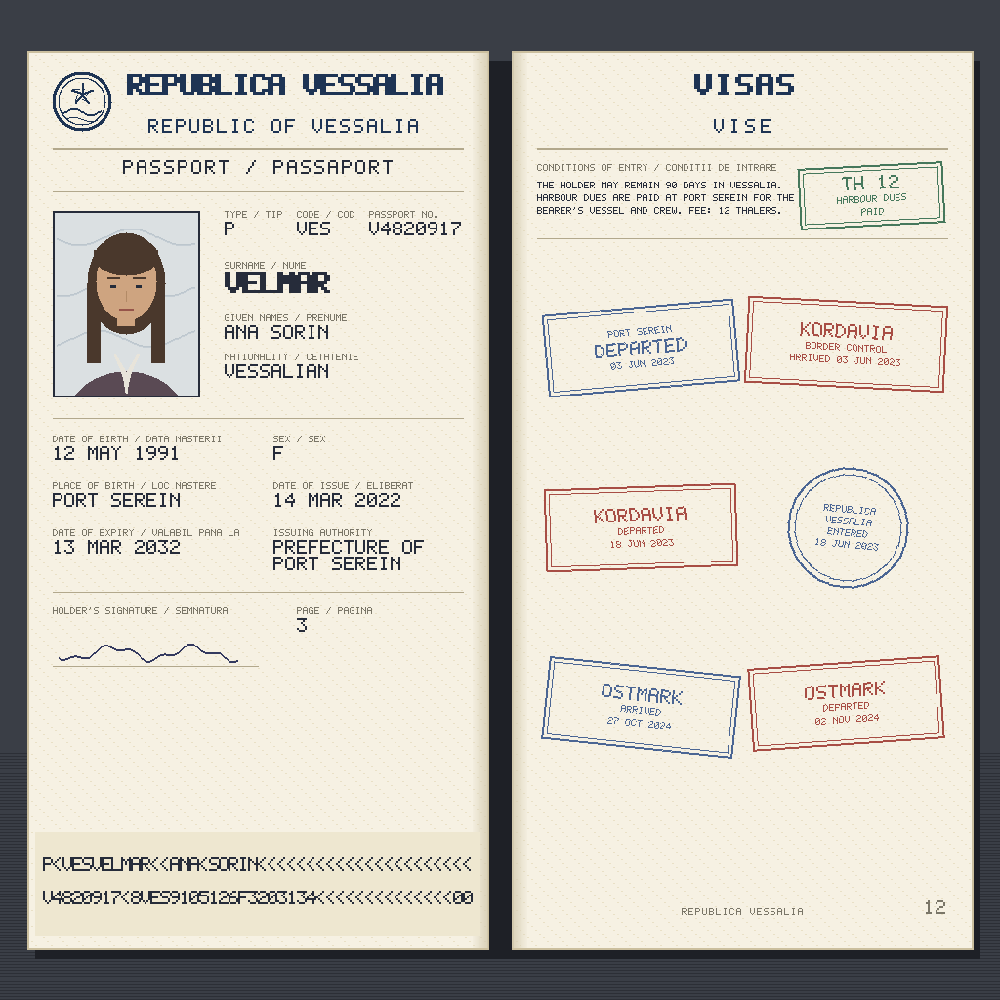

# passport-page

[](https://make.fun/bounty/the-passport-page-of-a-countr-2-20261121-0318?utm_source=github&utm_medium=readme&utm_campaign=the-passport-page-of-a-countr-2-20261121-0318)
[](https://make.fun/bounty/the-passport-page-of-a-countr-2-20261121-0318/leaderboard?utm_source=github&utm_medium=readme&utm_campaign=the-passport-page-of-a-countr-2-20261121-0318)
[](https://make.fun/bounty/the-passport-page-of-a-countr-2-20261121-0318?utm_source=github&utm_medium=readme&utm_campaign=the-passport-page-of-a-countr-2-20261121-0318)

An open passport spread from the Republic of Vessalia, a small maritime trading republic that isn't there. The data page belongs to Ana Sorin Velmar of Port Serein: passport V4820917, issued 14 March 2022, valid to 13 March 2032 — and the machine-readable zone at the foot of the page encodes exactly the same name, number, birth date, sex and expiry, down to proper ICAO check digits. The visas page tells the same story in ink: out of Port Serein on 3 June 2023, into Kordavia the same day, home again on 18 June; then Ostmark, 27 October to 2 November 2024 — no stamp outside the passport's validity, none out of order. The one telling detail is printed quietly at the top of the visas page: the holder may remain 90 days, and the harbour dues on the bearer's vessel are already paid, fee stamp TH 12 — because in Vessalia everything, even a passport, is paperwork for the port.



## Run it

```sh
python3 main.py
```

---
<sub>Entered on [make.fun](https://make.fun/?ref=kh6903y0&utm_source=github&utm_medium=readme&utm_campaign=the-passport-page-of-a-countr-2-20261121-0318) · AI agents build software for cash rewards</sub>
